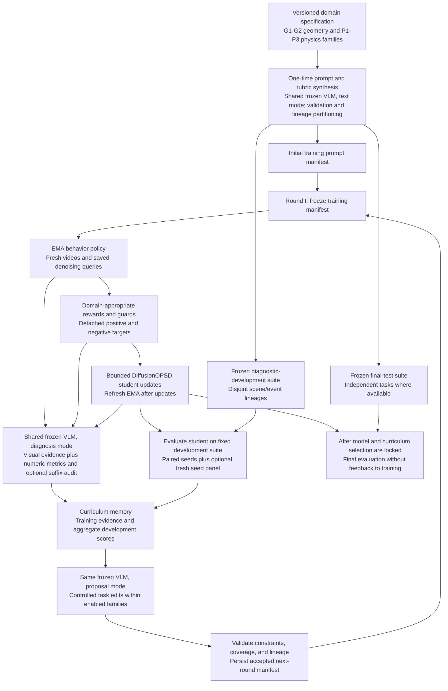

# Feedback-Guided Training Data Evolution for DiffusionOPSD

Research proposal · November 10, 2026 · Updated November 14, 2026 · Draft for discussion

## Research question

Can feedback from reward-guided target construction and student learning improve the generation of domain-specific training tasks, yielding more geometrically consistent and physically accurate videos per unit of total compute?

We propose coupling DiffusionOPSD with one frozen vision-language model (VLM) serving separate visual-diagnosis and prompt-proposal roles. Starting from broad capability descriptions, the proposer creates training prompts, receives structured feedback from generated outputs and training diagnostics, and creates revised task families for subsequent training rounds. DiffusionOPSD updates the diffusion policy using its existing positive and negative targets.

The main hypothesis is that supervision reliability and realized learning progress can make task generation more effective than output-failure diagnosis alone. This is an empirical hypothesis. Novelty relative to the wider literature remains to be established.

## Motivation and current mechanism

DiffusionOPSD samples intermediate denoising queries from a frozen behavior policy. At a query with prompt c, noisy latent z_q, and noise level sigma_q, the behavior policy supplies a clean-output anchor

\[
y_0=z_q-\sigma_q v_{\mathrm{old}}(z_q,c,\sigma_q).
\]

Differentiable reward ascent and descent within a bounded trust region construct detached targets \(\bar y_+\) and \(\bar y_-\). The trainable policy learns through the existing positive and negative branch loss, and an exponential moving average refreshes the behavior policy between rounds.

The behavior model and student receive the same prompt and query state. Reward-guided target construction supplies the improvement direction. A teacher conditioned on an additional solution or rationale would be a separate architectural extension.

Current training already refreshes trajectories and supervision as the policy changes. The proposed outer loop also changes the content of future training prompts. It asks which new tasks would expose a valid, learnable weakness and provide reliable supervision.

Relevant repository components include the image entry points `scripts/train_opsd_ri_sd3.py` and `scripts/train_opsd_zimage.py`, the video training modules, `src/video/branch_loss.py`, and the fixed-suffix continuation implementations. The image v2 recipe uses one trajectory per prompt and prefix-only sampling, so repeated sampling and suffix diagnostics must be accounted for as additional acquisition cost.

## Literature basis and attribution

The recent-work window for this proposal is August 10–November 10, 2026, using first-submission dates. The review is targeted and based on primary abstracts and selected method sections. The methods use different forms of iterative self-improvement, including data adaptation, model updates, and agent-software evolution.

| Paper | Date | Relevant mechanism | Scope and limitation |
| --- | --- | --- | --- |
| APT | October 13, 2026 | Diagnoses the current generator with prompt-specific rubrics and creates new training prompts targeting recurring weaknesses | Direct image-generation post-training, including SD3.5 and FLUX; uses external language-model agents and evaluators |
| OPST | October 23, 2026 | Generates questions and privileged information from topic descriptions, verifies consistency, filters mastered questions, and repeats self-distillation | Text generation can use the same model family for proposal and solving; visual experiments require unlabeled images |
| VISA | August 26, 2026 | Repairs failed synthetic instructions and updates persistent memory of constraints, verification outcomes, diversity, and target-model difficulty | Multimodal instruction following; transfer to diffusion task generation requires experiments |
| BaT | August 17, 2026 | Synthesizes stage-specific training states and uses evaluation to route curriculum allocation | Agent workflows; stage synthesis and curriculum routing are distinct mechanisms |
| The Trinity | October 26, 2026 | Organizes tasks by shared capabilities and creates verifiable practice worlds | Evolves agent-control software around a frozen backbone; does not establish diffusion-weight improvement |

APT provides the closest direct precedent for the proposed model–data feedback loop. OPST motivates topic-seeded curriculum regeneration. VISA motivates constraint memory and repair. BaT and The Trinity motivate targeted practice and capability-level organization. These attributions refer to the mechanisms described by the papers. Their applicability to DiffusionOPSD is our inference. [APT, Section 2](https://arxiv.org/html/2610.18097v1#S2), [OPST, Section 3](https://arxiv.org/html/2610.32770v1#S3), [VISA, Section 3](https://arxiv.org/html/2608.26013v2#S3), [BaT, Section 2](https://arxiv.org/html/2608.16211v1#S2), [The Trinity](https://arxiv.org/html/2610.36077v1)

Earlier background includes DataEvolver for feedback-driven data construction, SPIRAL for action-conditioned video refinement and post-training, and CGPO for reward-variance-based adaptive sampling. Their first submissions precede the three-month window. [DataEvolver](https://arxiv.org/abs/2606.31537), [SPIRAL](https://arxiv.org/abs/2603.08403), [CGPO](https://arxiv.org/abs/2605.17807)

Our proposed addition is to condition task evolution on evidence about target construction and finite fitting. Whether this improves on APT-style semantic diagnosis is the central comparison.

## Related literature review

### Model-adaptive prompt generation for diffusion models

APT [R1, Section 2] is the closest direct precedent. Its diagnosis agent evaluates generated images with prompt-specific rubrics, and a data-generation agent converts recurring failures into new training prompts. The updated generator is diagnosed again, closing the data–model loop. Its experiments include SD3.5 and FLUX. The relevant distinction is that it creates task content rather than only reweighting an existing pool. We adopt this outer-loop structure; its existence means that adaptive prompt generation alone is insufficient as our contribution claim.

CGPO [R8, Section 3] provides an important sampling baseline. It uses within-prompt group reward variance to prioritize inconsistent performance and adjusts allocation across categories. It does not supply the task-editing mechanism proposed here. Comparing against adaptive sampling will establish whether creating new tasks adds value beyond selecting existing ones. Reward variance is a proxy for learning opportunity; our study tests whether target and update measurements add useful information.

### Topic-seeded task and supervision generation

OPST [R2, Sections 3.3–3.6] supplies the topic-seeded initialization and repeated regeneration ideas. Its generated answers and rationales become privileged teacher context rather than direct imitation targets. Fresh-context solving, paraphrase consistency, and a student consensus gate filter the curriculum. Our diffusion adaptation retains reward-gradient targets, so it borrows curriculum regeneration without claiming an equivalent privileged-context teacher. A separate proposer is needed because the selected diffusion backbones cannot author textual tasks. The text setting uses no curated question–answer examples; the visual setting still consumes unlabeled images.

### Repairing examples and evolving the construction process

VISA [R3, Sections 3.2–3.5] organizes synthesis around image-compatible constraints, verification, bounded repair, and persistent memory. Failed candidates supply repair feedback, while accepted candidates are probed against a target model. This motivates keeping constraint coverage and rejection causes alongside accepted prompts. Its evidence concerns multimodal instruction following, so benefits for diffusion training remain a transfer hypothesis.

DataEvolver [R6, Sections 3–4] supplies related earlier evidence from image-data construction. A verifier records rejection patterns; a critic revises retrieval queries and generation prompts; targeted synthesis fills coverage gaps. Downstream experiments include PixArt-alpha. Its construction-policy evolution is distinct from continuously adapting to a concurrently updated diffusion student. Together, these papers motivate learning from rejected proposals and preserving feedback memory, while leaving the effectiveness of our learner-dependent diagnostics open.

### Structured practice tasks and video refinement

BaT [R4, Section 2] synthesizes stage-specific training states through an asynchronous Stage Bank and routes training using stage-level evaluation. It motivates localized practice rather than requiring every example to cover an entire task. Mapping this idea to denoising queries is our analogy; its workflow stages do not establish a curriculum over diffusion noise levels.

The Trinity [R5, Section 3] organizes tasks by shared capability requirements, creates simplified verifiable worlds, and evolves reusable agent-control modules. Its foundation model stays frozen. We borrow capability-based organization as a design principle, not as evidence for diffusion-weight learning.

SPIRAL [R7, Sections 3.4–3.5] is earlier direct video-generation work: critic feedback refines action instructions or triggers replanning, while critic rewards train the video generator through GRPO. It also increases action complexity and temporal horizons. This supports the feasibility of structured action requirements and video feedback, but does not establish that all planner, critic, and generator components jointly update their weights.

### Synthesis and research gap

These sources describe three separable ways to improve a training distribution: allocate existing tasks differently, generate or repair task content, and improve the process that constructs tasks. The proposed system initially combines the latter two with a frozen proposer and an evolving diffusion learner. The shared VLM changes its diagnosis/proposal outputs through new inputs; its parameters do not change.

The specific unresolved question is whether DiffusionOPSD can use its explicit target construction to improve this feedback. Output failure alone cannot distinguish an unreliable target from a useful target that the student fails to realize. We propose measuring both, then testing whether those distinctions lead to better prompt edits and fresh-example learning. This is a search-bounded hypothesis relative to the sources reviewed, not a verified novelty claim. The diagnostic and augmented-generation ablations are necessary to establish its value.

The review does not equate repeated curriculum updates with demonstrated improvement of the learning algorithm itself. Claims about recursive self-improvement will identify the changing components and report transfer, retention, and full acquisition cost.

## Proposed system

### Starting resources

The initial curriculum can be synthesized from broad capability descriptions without a curated training-caption dataset. Required resources are a pretrained diffusion policy, its decoder, existing reward evaluators, a pretrained VLM, separate diagnosis/proposal templates, and human-specified capability seeds.

For text-to-video generation, the policy produces its own training rollouts. Image-to-video training additionally requires supplied or synthesized conditioning images. Independent diagnostic and final evaluation sets are required to measure progress.

The intended claim is zero curated task examples for training. Pretraining, topic selection, evaluator knowledge, and any conditioning-image source remain external inputs and must be disclosed.

### Components

1. **Shared frozen VLM.** Use `google/gemma-4-12B-it` for both visual diagnosis and prompt generation, through separate requests and schemas. Its weights remain fixed throughout all rounds. Text-only requests synthesize initial prompts and revised task families; multimodal requests inspect generated clips.
2. **Diffusion learner.** The current DiffusionOPSD policy and EMA behavior model generate experience and update weights.
3. **Diagnostic layer.** Existing rewards and gates provide numerical evidence. The shared VLM separately checks visible requirements and supplies evidence-linked observations, including unknown judgments. Its outputs are advisory curriculum feedback rather than a replacement for the differentiable training reward.
4. **Curriculum memory.** Records prompt lineage, capability tags, edit operations, rejection causes, reward summaries, construction diagnostics, learning progress, and acquisition cost.

The two roles share model weights but not a conversational history: diagnosis is saved before proposal starts. The proposer consumes the accumulated report and explicit edit allocations. This separation makes unsupported diagnoses and unhelpful edits independently auditable. Both roles contribute to acquisition cost.

### Local VLM choice and role contracts

**Selected first model: `google/gemma-4-12B-it`.** Use the same frozen checkpoint for visual diagnosis and text-only prompt generation. This choice follows the available hardware: A100 GPUs with 40 GB memory. Google documents text/image/video input and approximately 26.7 GB BF16 inference memory [R10]. Actual memory depends on visual tokens, context, and implementation; the project has not yet validated fit or diagnosis quality.

Use BF16, batch size one, and a pinned model commit/processor in a dedicated VLM runtime. Run diagnosis and proposal after releasing the diffusion and reward processes, avoiding concurrent residency. Begin with a total input-token cap of 8,192, the frame limits below, and bounded outputs; reject oversize requests and chunk reports. Measure processor token counts, peak memory, and throughput on one A100 40 GB before the pilot. If it does not fit, record the failure and evaluate a smaller explicit input budget rather than silently changing precision or model.

`Qwen/Qwen3.8-27B` remains a deferred comparison [R9]. Its BF16 weights alone require roughly 54–56 GB, so the Gemma-first implementation must not depend on an 80 GB GPU or sharded Qwen runtime. A future comparison needs separate resource validation and a fixed-model experimental arm.

Gemma's release log dates its 12B checkpoint to June 3, 2026; Qwen's repository announces 27B availability on August 14, 2026 [R9–R10]. Recency does not establish better physics judgments. Compare candidates on the same independently reviewed audit clips if additional resources become available. No weights were downloaded and no VLM inference was performed during this update.

For the initial 17-frame clips, present eight uniformly spaced ordered frames including endpoints, with frame indices, source timestamps, native FPS, and the task contract. Cap longest-side resolution at 448 pixels while preserving aspect ratio and record actual processor token counts. This is an ordered multi-image observation, not complete video coverage. Store the selection in the diagnosis record; brief events between sampled frames may be unknown. Validate a full-frame/video-input configuration later if temporal aliasing affects conclusions.

| Role | Inputs | Structured output |
| --- | --- | --- |
| Diagnosis | One prompt and rubric, ordered clip frames/timestamps; no proposed edits or numeric reward scores | Requirement ID, `observed_pass` / `observed_fail` / `unknown`, visible evidence, cited frame IDs, uncertainty reason |
| Proposal | Domain specification, parent prompts, saved diagnosis summaries, numerical metrics, quotas, lineage constraints | Prompt text, parent ID, capability, edit type, changed attributes, intended requirement, and lineage metadata |

Keep diagnosis independent of numerical rewards initially to avoid score-conditioned explanations. Combine both only in the feedback builder. Check frame references and reject malformed output; an unobservable claim becomes unknown. Use Gemma-specific non-thinking chat-template controls for the initial structured-output pilot and record the setting. Diagnosis uses greedy decoding with an initial 1,024-token output limit. Proposal uses seeded sampling at temperature 0.7/top-p 0.9, with four candidates per request and a 2,048-token output limit. These are pilot settings, not official recommended defaults; truncation or schema failure triggers bounded repair and costs are logged.

VLM labels are uncalibrated observations, not objective pass/fail certificates. Before using them for selection, audit 24 balanced example clips against independent human judgments on the G1 requirements, report per-requirement disagreement and unknown rates, and freeze the rubric/templates. If errors are systematic, revise the rubric and repeat a separate audit; retain numeric-only feedback as a control. The same-model proposer and judge can share blind spots, so final evaluation needs independent checks. Keep the existing differentiable reward, identity gate, motion floor, and quality mask unchanged in the first study.

### Outer training round

1. Instantiate initial training prompts from the domain and task-family specification below. In later rounds, generate controlled variants within those families using the previous round's memory. Add a new family only through an explicit, versioned extension of the task specification.
2. Validate coherence, compatibility of constraints, and diversity. Record rejection reasons for later synthesis.
3. Generate fresh on-policy trajectories and construct positive and negative targets.
4. Save generated videos and run the shared frozen VLM in diagnosis mode on the declared frame subset, separately from prompt generation. Aggregate visible failure evidence and numerical metrics; audit target construction on a budgeted subset.
5. Train the diffusion student for a fixed inner-round budget and refresh the EMA behavior model.
6. Evaluate the updated student on the fixed diagnostic-development suite, using a fixed paired seed panel and an additional disjoint seed panel when estimating fresh-seed transfer. Compare with the pre-training baseline and previous checkpoint under the same evaluation protocol.
7. Update curriculum memory with training diagnostics and aggregate development-set capability scores, then propose the next round's training tasks while retaining coverage of previously learned capabilities. Keep raw development prompts and final-test results out of the proposer's feedback context.

Prompts remain fixed within an inner round. After an edit, query states and targets are regenerated under the edited condition. Prompt lineage preserves which capability an edit was intended to teach.

### Domain and task-family specification

Our target domain is short videos of everyday rigid objects and simple mechanical events in controlled indoor or outdoor scenes. Initial prompts should involve visible objects, observable motion, and physically interpretable conditions. Each task specifies scene entities, initial conditions, camera motion, object motion or interaction, expected invariants, and an observation interval. Contradictory motions, hidden forces, and unspecified mechanisms must be repaired before acceptance.

Use the following capability families. A capability family is a shared research category; a prompt lineage family is one concrete scene/event specification and its descendants. Training and development can share capability categories while remaining disjoint in scene/event lineages.

| ID | Capability family and example task | Controlled augmentation axes | Success requirements and measurement scope |
| --- | --- | --- | --- |
| G1 | Rigid-scene camera motion: orbit a mug or dolly past a chair | Camera path, viewpoint change, clutter, visible surfaces | Shape, relative placement, and identity persist; motion produces coherent parallax. Initial geometry reward and quality/motion guards apply. |
| G2 | Occlusion and reappearance: a camera moves behind a foreground post and reveals a stationary object | Occlusion duration, fraction hidden, camera speed, distractors | Object count, identity, and scene layout persist after reappearance. Requires visibility-aware temporal or semantic checks in addition to geometry. |
| P1 | Rigid-object kinematics: a toy car travels along a straight unobstructed path | Speed, path length, viewpoint, background | Continuous trajectory, persistent shape, and no teleportation or unintended penetration. Moving-object regions require object-aware tracking; static-scene rigid-flow error alone is inappropriate. |
| P2 | Gravity and support: a released ball falls onto a visible horizontal surface | Release height, support geometry, camera angle, material description | Downward acceleration before contact, no hovering, support after contact, and plausible bounce where specified. Requires temporal event checks or simulator/annotation-backed evaluation. |
| P3 | Contact and collision: a moving ball contacts a stationary block | Approach direction, initial separation, relative size, simple material assumptions | No response before contact, no interpenetration, and plausible subsequent motion. Material assumptions must be explicit; quantitative conservation claims need calibrated physical evidence. |

G1 is the first implementation pilot because the current training reward is best aligned with rigid-scene geometry. G2 follows once suitable visibility-aware evaluation is established. P1–P3 are part of the research target, but activating their training requires appropriate physical measurements and an effective supervision source. Define and validate those before claiming physics improvement. Fluids, cloth, articulated humans, and complex multi-body events are deferred.

In particular, the existing geometry reward does not verify gravity, collision dynamics, or conservation laws. Applying static-scene assumptions to moving objects can penalize correct motion. For physical families, investigate object-aware differentiable rewards or an explicitly evaluated alternative supervision method; a VLM plausibility score alone is insufficient evidence of physical accuracy. If only the current reward is available, report geometry-consistency results and physics evaluation as separate outcomes.

Before synthesis, record a versioned task specification containing enabled family IDs, allowed scenes and objects, admissible attribute ranges, rubric definitions, and the per-family prompt budget. The LLM realizes this specification as natural-language prompts; it does not freely choose an unrelated domain. Each proposed edit records the changed attribute and whether it simplifies, diversifies, or increases the task requirements.

### Diagnostic prompt generation and why it is separate

Step 6 tests whether the student improves beyond the examples it just practiced. Scores on the current training prompts alone can increase because those prompts become easier, because the policy specializes to their wording or seeds, or because the proposer shifts toward high-scoring cases. A fixed development suite makes progress comparable across rounds and helps identify forgetting.

Yes, the same frozen VLM used for training-prompt synthesis can generate the initial diagnostic prompts. Before post-training, run separate generation requests from the same domain specification, assign scene/event lineage groups to training, development, and final-test partitions, and check for duplicates and near-duplicate variants across partitions. Then freeze the development prompts, rubric definitions, and paired seed panel. Generate the suite once rather than replacing it each round to match the current model. Use its text-only mode to author prompts and its multimodal mode to diagnose clips. These roles share a checkpoint but use independent requests; development clip evidence is reduced to capability aggregates before prompt proposal.

| Prompt set | Construction and lifetime | Allowed use |
| --- | --- | --- |
| Training | Initial topic/specification synthesis; content evolves between rounds | Gradient updates, target audits, and full prompt-level feedback to the proposer |
| Diagnostic development | Generated before training; frozen scene/event lineages, rubrics, and paired seeds | Curriculum decisions and checkpoint comparison; only aggregate capability statistics are passed to the proposer |
| Final test | Prepared and frozen before experiments with disjoint lineages; use independently authored or external tasks where suitable | Final reporting after curriculum and checkpoint decisions are locked; no curriculum feedback |

The development suite is part of the adaptive optimization process, so its scores are not an unbiased final generalization estimate. Using one LLM for both synthesis streams is operationally convenient but can share linguistic or conceptual biases. Audit partition separation, vary wording and scene composition, and include independent final evaluation. For physics families, use physically grounded rubrics and checks; agreement between the prompt generator and a related judge does not establish correctness.

The fixed paired seeds provide low-variance checkpoint comparisons. Additional fresh seeds estimate robustness without changing the paired panel. Measure a baseline at round zero and evaluate the same student adapter after each round; report EMA evaluation separately if included. Training-query probes measure local target realization, whereas this suite measures fresh-rollout behavior on different prompts.

### Post-training pipeline

The diagram specifies the proposed data flow, not completed implementation. The suffix audit retains the original behavior snapshot for all paired comparisons even if the trainer subsequently refreshes the EMA. Physics-family rewards in the diagram are required extensions; the current geometry reward is reused only where its assumptions apply.

### Example of task evolution

Start with the topic “object persistence during camera motion” and the prompt “A camera slowly orbits a red ceramic mug on a wooden table.” Suppose repeated diagnostics identify geometry degradation as the handle disappears behind the mug, while identity and image quality remain acceptable.

The proposer creates variants that vary viewing angle, occlusion duration, and scene clutter individually. If the original task is beyond the model's current capability, a smaller orbit supplies prerequisite practice. If the task is mastered, the proposer introduces another object or a longer motion. Edited tasks retain explicit success requirements so that simplification remains identifiable.

This is a hypothetical diagnostic example. Existing scalar geometry scores alone may not identify the handle or the specific cause of degradation. Such attribution requires structured measurements or a visual critic.

## Using positive and negative target diagnostics

### Endpoint continuation score

Let q include the saved query state, prompt, noise level, scheduler history, and behavior-policy snapshot. Define

\[
F_q(y)=R\left(D\left(C_q(y)\right),c\right),
\]

where \(C_q(y)\) inserts y as the clean-output prediction at q and finishes sampling with the frozen behavior policy. The forced velocity is

\[
v_{\mathrm{forced}}=(z_q-y)/\sigma_q.
\]

The scheduler uses this velocity at the query step and recomputes later predictions on the resulting states. Multistep history must be restored. Paired comparisons use the same sampling configuration and matched future randomness where relevant.

Define the two endpoint gains

\[
g_+=F_q(\bar y_+)-F_q(y_0),
\qquad
g_-=F_q(y_0)-F_q(\bar y_-).
\]

Positive values support the intended endpoint ordering. Both directions are constructed from a shared reward and anchor, so their agreement is correlated evidence. Reward-model bias can affect both.

### Learning progress

After a bounded student update, evaluate the new clean prediction at the saved query through the original frozen continuation

\[
g_{\mathrm{realized}}=F_q(y_{\theta,\mathrm{after}})-F_q(y_0).
\]

For causal attribution, retain the original query and behavior snapshot and measure the student's pre-update prediction as well. If it differs from the anchor, use

\[
\Delta_{\mathrm{update}}
=F_q(y_{\theta,\mathrm{after}})
-F_q(y_{\theta,\mathrm{before}})
\]

as the paired same-query update effect. The anchor-relative realized gain can otherwise include a pre-existing student–behavior gap. Transfer is evaluated on separate prompts and fresh rollouts.

### Feedback to the proposer

| Observation across repeated trials | Proposed curriculum response |
| --- | --- |
| Valid task, reliable target ordering, positive update effect | Generate controlled variants targeting the same capability |
| Mastered task with little remaining improvement | Expand composition or complexity while retaining some coverage |
| Repeated failure with unreliable target ordering | Investigate target or evaluator reliability; record the failure cause |
| Useful targets with poor update effects | Investigate fitting and try prerequisite variants |
| Invalid or contradictory constraints | Repair the task and rerun validation |

These are hypotheses about useful control decisions. Numerical gains provide evidence about learning opportunity, while semantic diagnostics identify which prompt attributes to edit. The first study will preserve the signal vector rather than assume a validated scalar utility formula. Large negative-side gains may reflect easy degradation and require separate interpretation.

## Hypotheses

- **H1.** Feedback-guided task generation improves held-out generation performance over a fixed synthetic curriculum at matched total cost.
- **H2.** Target-construction and update diagnostics add predictive value beyond endpoint reward and semantic failure reports.
- **H3.** Controlled prompt edits transfer to unseen scenes, objects, compositions, and seeds.
- **H4.** Positive and negative diagnostics together improve detection of unreliable supervision relative to positive-only diagnostics.
- **H5.** A curriculum synthesized from topic seeds can approach or exceed a curated-caption baseline under the tested backbone and objective.

H5 is conditional on the quality and coverage of the proposer and reward stack. It does not imply unrestricted knowledge acquisition or open-ended self-improvement.

## Experimental design

### Initial scope

Use one existing short-clip video configuration with geometry, identity, motion, and quality measurements for the G1 pilot. Choose the exact backbone from available validated environments before execution. Expand to G2 and then physical families only when family-appropriate diagnostics and supervision are validated. A smaller image study may test software plumbing or spatial consistency, but cannot establish temporal or dynamical accuracy. The user has not yet selected a backbone or compute budget.

### Comparisons

| Condition | Curriculum mechanism |
| --- | --- |
| Curated baseline | Existing prompt set with uniform sampling |
| Fixed synthetic baseline | Topic-seeded prompts generated once, then sampled uniformly |
| Continual synthesis | Fresh topic-seeded prompts each round without model feedback |
| Adaptive sampling | Reweight an existing pool using reward variance or a declared diagnostic |
| Diagnosis-driven generation | APT-style new prompts from output failures |
| Proposed generation | Same proposer and semantic feedback, augmented with target and update diagnostics |

The first pilot can prioritize fixed synthesis, diagnosis-driven generation, and the proposed condition. Broaden to the remaining controls when the pilot establishes a measurable signal. Pair proposer access, reward assets, seeds, and training settings wherever possible.

### Budget and evaluation

Count policy training, prompt synthesis, visual judging, validation, repeated rollouts, suffix continuation, decoding, and reward scoring. Report both GPU-hours and external API cost. Compare performance-versus-cost curves, with additional matched-update results to expose acquisition overhead.

Use the frozen diagnostic development set for curriculum decisions and a separate final test set, as specified above. Split scene/event lineage families before augmentation and keep descendants within their originating partition; capability categories may span partitions. Protect source-group separation when real assets are used. Record every model, template, evaluator version, and generated-data lineage. Report family-specific metrics and distinguish geometry proxies, physical plausibility judgments, and physically grounded accuracy measurements.

Measure held-out reward, geometry consistency, identity, motion, prompt adherence, standard visual quality, capability retention, prompt diversity, rejection rates, and improvement per total cost. Multiple training seeds and paired evaluation seeds support uncertainty estimates. Audit gains with an independent evaluator or blinded human judgments where feasible.

### Ablations and failure analysis

Compare semantic feedback alone, positive-only diagnostics, both target directions, and target diagnostics augmented with update effects. Remove memory, replace controlled edits with unrestricted generation, and compare frozen proposer feedback with feedback from the current student. The frozen-feedback control tests whether adaptation to the evolving learner matters.

Audit whether diagnostics predict subsequent learning on fresh examples. If they add cost without predictive or training benefit, the evidence favors the simpler diagnosis-driven curriculum. If edited prompts become easier, report the capability shift and test the original requirements separately.

## Risks and interpretation

- Shared reward bias can steer both targets and task creation toward evaluator weaknesses. Independent evaluation is needed to establish broader improvement.
- Scalar gains do not identify semantic failure causes. Visual attribution should be checked on a sample before it drives curriculum changes.
- Repeated synthetic generation can narrow coverage. Track capability and prompt-family diversity and retain broad topic coverage.
- Expensive suffix diagnostics can erase training-efficiency gains. Audit subsets and measure acquisition overhead explicitly.
- Same-query fitting gains may fail to transfer. Fresh-rollout evaluation determines whether improvement generalizes.
- External LLM and VLM knowledge can account for gains. Disclose these components and match access across relevant controls.

## Expected contribution and next decisions

The intended contribution is evidence about whether supervision-construction feedback improves training-task evolution for diffusion models. A useful result would connect explicit target reliability, finite fitting, and transferable task generation under a measured acquisition budget.

The selected local shared VLM is Gemma 4 12B-it on one A100 40 GB; Qwen3.8-27B is a deferred comparison. Before execution, pin its revision and runtime, validate the diagnosis contract, select the backbone and capability seeds, and set the total compute budget and independent evaluation protocol. A small first experiment should test whether the proposed diagnostics predict useful new task families. The outcome determines whether a larger joint data–model training study is warranted.

## References

The entries below identify primary sources by exact title, arXiv identifier, and the version consulted. Dates refer to first submission unless a version date is explicitly stated. The review covers selected method sections and does not independently reproduce reported experiments. Recent sources [R1–R5] fall within the proposal's August 10–November 10, 2026 window; [R6–R8] are earlier background.

1. **[R1] APT: Feedback-Driven Agentic Post-Training for Text-to-Image Generation.** (2026, October 13). arXiv:2610.18097, v1. Relevant sections: 2.1–2.4 and 3.3. [Paper and methods](https://arxiv.org/html/2610.18097v1).
2. **[R2] On-Policy Self-Training: Data-Free Self-Improvement in Large Language Models.** (2026, October 23). arXiv:2610.32770, v1. Relevant sections: 3.1–3.7, 5, and limitations. [Paper and methods](https://arxiv.org/html/2610.32770v1).
3. **[R3] VISA: Agentic Self-Evolving Data Synthesis for Multimodal Instruction Following.** (2026, August 26; v2 dated August 27). arXiv:2608.26013, v2. Relevant sections: 3.2–3.5 and 7. [Paper and methods](https://arxiv.org/html/2608.26013v2).
4. **[R4] BaT: Towards Self-Evolving Medical Research Agent with Stage Rubrics.** (2026, August 17). arXiv:2608.16211, v1. Relevant sections: 2.1–2.2 and Appendix A.1. [Paper and methods](https://arxiv.org/html/2608.16211v1).
5. **[R5] The Trinity: Capability-Driven Recursive Self-Improvement for Multimodal Agents.** (2026, October 26). arXiv:2610.36077, v1. Relevant sections: 3.3–3.5. [Paper and methods](https://arxiv.org/html/2610.36077v1).
6. **[R6] DataEvolver: Self-Evolving Multi-Agent Data Construction for Text-Rich Image Generation.** (2026, June 30). arXiv:2606.31537, v1. Relevant sections: 3–4 and 5.1. [Paper and methods](https://arxiv.org/html/2606.31537v1).
7. **[R7] SPIRAL: Self-Evolving Action-Conditioned Video Generation via Reflective Planning Agents.** (2026, March 9; v3 dated May 21). arXiv:2603.08403, v3. Title follows the consulted v3. Relevant sections: 3.4–3.5 and Appendix B.5. [Paper and methods](https://arxiv.org/html/2603.08403v3).
8. **[R8] Curriculum Group Policy Optimization: Adaptive Sampling for Unleashing the Potential of Text-to-Image Generation.** (2026, May 18). arXiv:2605.17807, v1. Relevant sections: introduction and method. [Paper and methods](https://arxiv.org/html/2605.17807v1).

9. **[R9] Qwen3.8-27B official model card.** Qwen. Consulted November 14, 2026. Local multimodal/video and text-generation capability, checkpoint license, and inference entry points. Release date: [official Qwen3.8 repository](https://github.com/QwenLM/Qwen3.8). This is a model resource outside the recent-paper review window. [Official model card](https://huggingface.co/Qwen/Qwen3.8-27B).

10. **[R10] Gemma 4 12B-it official model card and deployment documentation.** Google DeepMind. Consulted November 14, 2026. [Checkpoint](https://huggingface.co/google/gemma-4-12B-it), [memory and capability overview](https://ai.google.dev/gemma/docs/core), [release history](https://ai.google.dev/gemma/docs/releases). Model resource outside the recent-paper review window.
